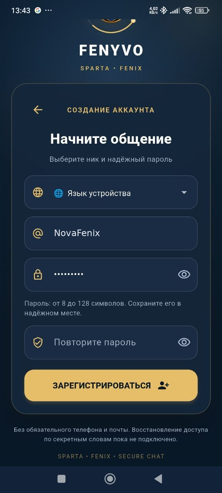
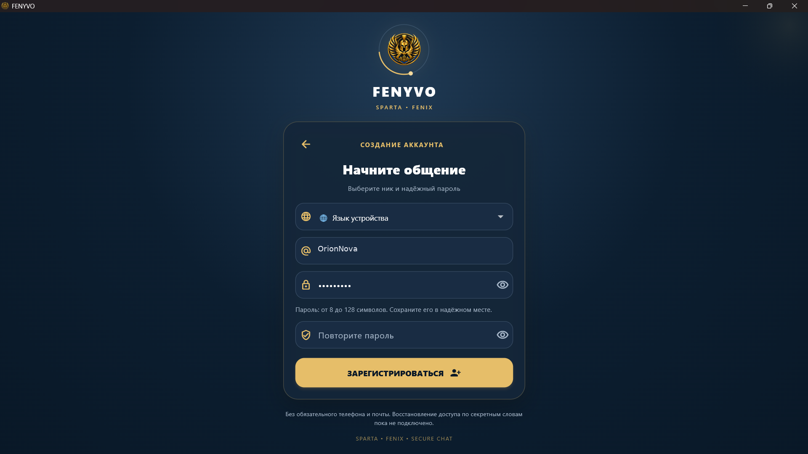

# FENYVO

[English](README.md) | [Українська](README_UK.md) | [Русская](README_RU.md)

Private messaging. Modern communication.

FENYVO is a messenger for Android and Windows.

## Download

Public release: 1.8.0 (Build 4234)

- [Android APK](https://fenyvo.com/download/Fenyvo-1.8.0-arm64.apk)
- [Windows ZIP](https://fenyvo.com/download/Fenyvo-1.8.0-windows-x64.zip)

Official website: https://fenyvo.com

## Features

- Private and group chats
- Voice and video calling
- Group calls
- Media sharing
- End-to-end encryption features
- Android and Windows applications

## Screenshots

### Android

### Windows

## Privacy

FENYVO is developed with a focus on privacy and secure communication.

Privacy policy: https://fenyvo.com/privacy.html

## Source code

This repository provides public information about FENYVO.
The application and server source code are not included.

## Support

https://fenyvo.com/support.html

