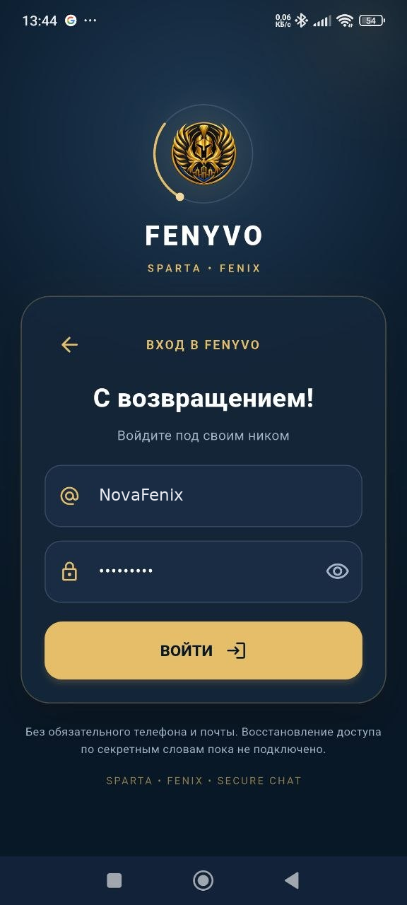
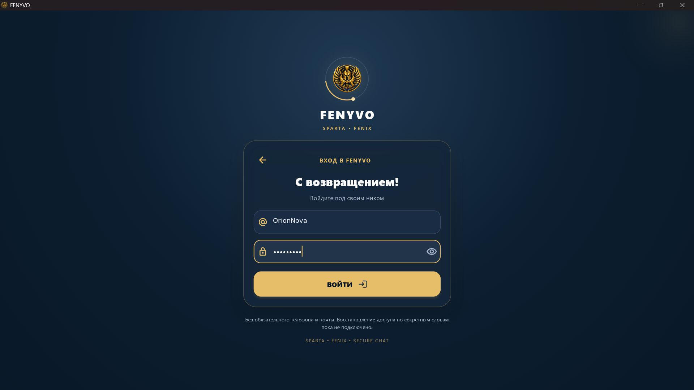

# FENYVO

[English](README.md) | [Українська](README_UK.md) | [Русская](README_RU.md)

**Мессенджер для Android и Windows**

FENYVO — приложение для личных и групповых чатов, голосовых и видеозвонков и обмена медиафайлами.

## Скачать

Версия **1.8.0**, сборка **4234**.

- [Android APK](https://fenyvo.com/download/Fenyvo-1.8.0-arm64.apk)
- [Windows ZIP](https://fenyvo.com/download/Fenyvo-1.8.0-windows-x64.zip)

Официальный сайт: https://fenyvo.com

## Возможности

- Личные и групповые чаты
- Голосовые и видеозвонки
- Групповые звонки
- Отправка медиафайлов
- Функции сквозного шифрования

## Скриншоты

## Конфиденциальность

[Политика конфиденциальности](https://fenyvo.com/privacy.html)

## Исходный код

Здесь размещается публичная информация о FENYVO. Исходный код приложения и сервера не публикуется.

## Поддержка

https://fenyvo.com/support.html
